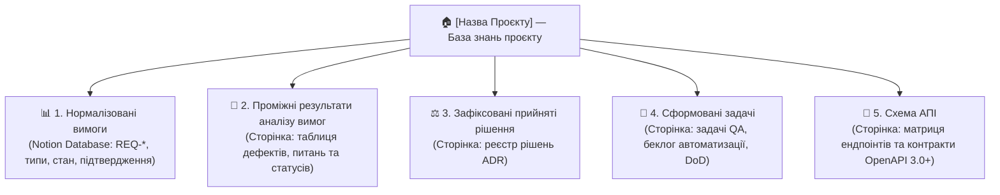

# Notion Project Init (Скіл Першого Запуску та Ініціалізації Проєкту в Notion)

Цей скіл виконує первинне розгортання повної інфраструктури бази знань проєкту в Notion «з нуля». Він створює ієрархію з 5 спеціалізованих розділів, конфігурує базу даних нормалізованих вимог із усіма необхідними типами полів, підпорядковані сторінки з еталонними шаблонами та автоматично прив'язує згенеровані Notion ID до локальних файлів репозиторію.

Усі створювані сторінки, описи, таблиці та шаблони ведуться **виключно українською мовою**.

---

## 🏗️ Архітектура Структури, Що Створюється в Notion



---

## 🔄 Покроковий Процес Ініціалізації (Step-by-Step Setup)

### Крок 1. Узгодження параметрів із користувачем
Перед початком створення агент уточнює у користувача:
1. **Назва проєкту**: наприклад, *«База знань: Сервіс Авторизації»* або *«Проєкт CRM»*.
2. **Батьківське розташування в Notion**:
   - Створити як кореневу сторінку у воркспейсі (за замовчуванням).
   - Або розмістити всередині існуючої батьківської сторінки (якщо користувач надасть `parent_page_id` чи URL).

---

### Крок 2. Створення кореневої сторінки проєкту
Викликати інструмент `notion-create-pages`:
- **Заголовок**: `[Назва проєкту] — База знань проєкту`
- **Іконка**: `📚`
- **Вміст**:
  ```markdown
  ## 🧭 Навігація по Базі Знань Проєкту

  Ласкаво просимо до центральної бази знань проєкту. Тут консолідуються всі вимоги, результати їхнього аналізу, архітектурні рішення стейкхолдерів, задачі на тестування та специфікації API.

  ### 🗂️ Розділи бази знань:
  1. **1. Нормалізовані вимоги** — офіційний реєстр атомарних вимог зі статусами узгодження.
  2. **2. Проміжні результати аналізу вимог** — робочий простір аудиту якості, дефектів та відкритих питань.
  3. **3. Зафіксовані прийняті рішення** — журнал архітектурних та бізнес-рішень (ADR).
  4. **4. Сформовані задачі** — декомпозиція тест-планів та задач автоматизації.
  5. **5. Схема АПІ** — контракти OpenAPI 3.0+, матриця ендпоінтів та моделі DTO.
  ```

Зберегти отриманий `page_id` кореневої сторінки як `ROOT_PAGE_ID`.

---

### Крок 3. Створення бази даних «1. Нормалізовані вимоги»
Викликати інструмент `notion-create-database`:
- **Батьківський елемент (`parent`)**: `{"type": "page_id", "page_id": ROOT_PAGE_ID}`
- **Заголовок (`title`)**: `1. Нормалізовані вимоги`
- **Опис (`description`)**: `Реєстр атомарних вимог проєкту із фіксацією статусу узгодження та відповідального стейкхолдера/агента.`
- **Схема SQL DDL (`schema`)**:
  ```sql
  CREATE TABLE (
    "Назва" TITLE,
    "ID нормалізованої вимоги" UNIQUE_ID PREFIX 'REQ',
    "Нормалізована вимога" RICH_TEXT,
    "Тип" SELECT('Функціональна':blue, 'Нефункціональна':purple, 'Бізнес-вимога':green, 'Технічна':orange, 'Інтеграційна':pink),
    "Джерело" RICH_TEXT,
    "Нормалізація" RICH_TEXT,
    "Стан" STATUS('потребує аналізу':gray:to_do, 'в процесі аналізу':blue:in_progress, 'узгоджено':green:complete, 'відхилено':red:complete),
    "Ким підтверджено" RICH_TEXT
  )
  ```
Зберегти отриманий `data_source_id` (`collection://...`) та `database_id`.

---

### Крок 4. Створення 4 підпорядкованих розділів
Викликати `notion-create-pages` із `parent: {"type": "page_id", "page_id": ROOT_PAGE_ID}` для створення 4 сторінок:

#### 1) «2. Проміжні результати аналізу вимог»
- **Іконка**: `📝`
- **Заголовок**: `2. Проміжні результати аналізу вимог`
- **Вміст**:
  ```markdown
  ## 📝 Проміжні результати аналізу вимог

  У цьому розділі фіксуються дефекти вимог, прогалини, суперечності, відкриті запитання до бізнес-аналітиків/PO та варіанти їхнього вирішення.

  ### 📋 Реєстр дефектів та відкритих питань

  | ID вимоги | Назва вимоги | Виявлена проблема / Дефект | Відкриті запитання (до BA / PO) | Пропозиції щодо вирішення (Варіанти) | Статус у блоці аналізу |
  |---|---|---|---|---|---|
  | *REQ-X* | *[Приклад]* | *Опис дефекту вимоги...* | *1. Уточнююче запитання?* | *Варіант А / Варіант Б* | `Нова проблема` |

  > [!NOTE]
  > Якщо вимога має статус **«взята в роботу»** або **«вирішена»** (`✅ Вирішено`), скіл `requirements-resolver` автоматично виключає її з локального файлу опитування.
  ```

#### 2) «3. Зафіксовані прийняті рішення»
- **Іконка**: `⚖️`
- **Заголовок**: `3. Зафіксовані прийняті рішення`
- **Вміст**:
  ```markdown
  ## ⚖️ Зафіксовані прийняті рішення (ADR Log)

  Журнал прийнятих архітектурних, бізнес- та технічних рішень щодо вимог проєкту.

  ---

  ### 📌 Шаблон запису рішення:
  ### ⚖️ ADR-[Номер]: [Коротка назва рішення]
  - **Статус:** Затверджено
  - **Ким підтверджено:** [ПІБ та роль стейкхолдера / AI Agent]
  - **Дата прийняття:** [РРРР-ММ-ДД]
  - **Контекст проблеми:** [Опис дефекту, суперечності або бізнес-потреби]
  - **Прийняте рішення:** [Чітке формулювання затвердженого правила]
  - **Наслідки:** [Вплив на автотести, архітектуру чи логіку бекенду]
  ```

#### 3) «4. Сформовані задачі»
- **Іконка**: `🎯`
- **Заголовок**: `4. Сформовані задачі`
- **Вміст**:
  ```markdown
  ## 🎯 Сформовані задачі тестування та автоматизації

  Розділ для декомпозиції тест-планів, задач розробки автотестів (Cypress / Playwright / API) та відстеження готовності критеріїв Definition of Done.

  ---

  ### 🚀 Спринт / Модуль: [Назва]
  - [ ] **TASK-1:** [Опис задачі тестування]
  - [ ] **TASK-2:** [Опис задачі автоматизації]
  
  **Критерії готовності (Definition of Done):**
  - [ ] 100% покриття узгоджених вимог тест-кейсами.
  - [ ] Успішне проходження регресійного набору в CI/CD пайплайні.
  ```

#### 4) «5. Схема АПІ»
- **Іконка**: `🔌`
- **Заголовок**: `5. Схема АПІ`
- **Вміст**:
  ```markdown
  ## 🔌 Схема АПІ та Контракти (OpenAPI 3.0+)

  Розділ для зберігання машинно-читабельних та структурованих специфікацій REST API проєкту, згенерованих скілом `openapi-spec-generator`.

  ---

  ### 🌐 Оглядова матриця ендпоінтів
  | Метод | Шлях (Endpoint) | Тег / Модуль | Призначення | Авторизація | Успіх | Помилки |
  |---|---|---|---|---|---|---|
  | `GET` | `/api/v1/health` | `System` | Перевірка працездатності сервісу | Ні | `200 OK` | `500` |
  ```

---

### Крок 5. Автоматичне оновлення локальних посилань

Після успішного створення всіх елементів скіл оновлює файли в поточному репозиторії:
1. **`README.md`**:
   - Оновлює секцію `## 🔗 Швидкі посилання в Notion`, проставляючи нові створені URL та ID.
2. **`.agents/skills/knowledge-base-manager/SKILL.md`**:
   - Оновлює URL кореневої сторінки та таблицю розділів із новими Page ID та Data Source URL.
3. **Локальні папки та безпека Git**:
   - Перевіряє наявність `.gitignore` з виключенням `clarifications/`.
   - Забезпечує існування папки `clarifications/`.

---

### Крок 6. Фінальний звіт користувачеві

Агент виводить структурований звіт із клікабельними лінками:
- 🏠 **Коренева сторінка**: посилання на створену базу знань.
- 📊 **1. Нормалізовані вимоги**: посилання на базу даних.
- 📝 **2. Проміжні результати аналізу вимог**: посилання на сторінку.
- ⚖️ **3. Зафіксовані прийняті рішення**: посилання на сторінку.
- 🎯 **4. Сформовані задачі**: посилання на сторінку.
- 🔌 **5. Схема АПІ**: посилання на сторінку.
- 💡 **Рекомендований наступний крок**: запуск імпорту вимог за допомогою команди `«Нормалізуй вимоги з [джерело]»` або виклик майстер-скіла `knowledge-base-manager`.
