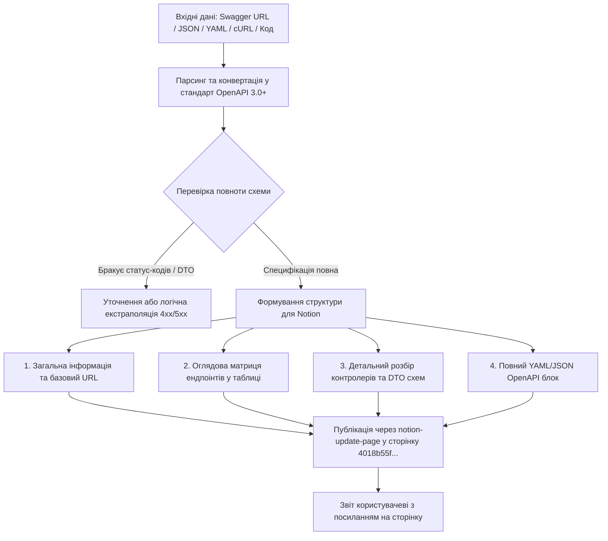

# OpenAPI Spec Generator (Генератор Специфікацій OpenAPI / Swagger)

Цей скіл призначений для вилучення, структурування, валідації та публікації специфікацій **OpenAPI 3.0+** на основі Swagger-документації або сирих описів API, з автоматичним збереженням результатів на сторінці **[5. Схема АПІ](https://app.notion.com/p/4018b55f9a7e8182bcf2f14567c2c329)** у базі знань Notion.

Усі описи, документація, аналітичні нотатки та діалоги ведуться **виключно українською мовою**.

---

## 🎯 Цільова Сторінка в Notion

- **Розділ Бази Знань:** `5. Схема АПІ`
- **Page ID:** `4018b55f-9a7e-8182-bcf2-f14567c2c329`
- **Пряме посилання:** [Відкрити «5. Схема АПІ» в Notion](https://app.notion.com/p/4018b55f9a7e8182bcf2f14567c2c329)

---

## 📥 Підтримувані Вхідні Джерела

1. **URL Swagger UI / OpenAPI JSON:**
   - Посилання на Swagger UI (`/swagger`, `/docs`, `/api-docs`).
   - Посилання на сирий файл схеми (`/swagger/v1/swagger.json`, `/openapi.json`, `/v3/api-docs`).
   - Читання через `read_url_content` або браузерний субагент за потреби.
2. **Файли специфікацій у репозиторії:**
   - Локальні файли `.json`, `.yaml`, `.yml` (Swagger 2.0 або OpenAPI 3.x).
3. **Текстовий опис ендпоінтів із чату чи тікетів:**
   - cURL команди, приклади запитів/відповідей, описи маршрутів у Jira/Confluence.
4. **Вихідний код контролерів / роутів:**
   - Анотації Swagger/NestJS/Spring/FastAPI/Express у коді проєкту.

---

## 🔄 Робочий Процес (Workflow)



---

## 📋 Стандарти Форматування для Сторінки «5. Схема АПІ»

При збереженні в Notion контент публікується у структурованому вигляді:

### 1. Заголовний блок модуля / сервісу
```markdown
## 🔌 Специфікація API: [Назва сервісу або модуля] (v[Версія])

- **Базовий URL (Base URL):** `https://api.example.com/api/v1`
- **Тип авторизації:** `Bearer JWT` (заголовок `Authorization: Bearer <token>`)
- **Дата генерації / оновлення:** [ДД.ММ.РРРР]
- **Джерело:** [Swagger UI URL або файл схеми]
```

### 2. Оглядова матриця ендпоінтів
| Метод | Шлях (Endpoint) | Тег / Модуль | Призначення | Авторизація | Успіх | Помилки |
|---|---|---|---|---|---|---|
| `POST` | `/auth/login` | `Auth` | Аутентифікація користувача | Ні | `200 OK` | `400`, `401`, `500` |
| `GET` | `/users/me` | `Users` | Отримання профілю поточного користувача | Так (Bearer) | `200 OK` | `401`, `404` |
| `POST` | `/orders` | `Orders` | Створення нового замовлення | Так (Bearer) | `201 Created` | `400`, `401`, `422` |

### 3. Детальний опис ендпоінтів (Розбивка за тегами/контролерами)
Для кожного контролера наводяться ендпоінти з наступними обов'язковими деталями:
- **Метод і URL**: наприклад, `POST /api/v1/auth/login`
- **Заголовки (Headers)**: `Content-Type: application/json`, `Accept: application/json`
- **Параметри запиту**: Path, Query, Header (тип, обов'язковість, валідація)
- **Тіло запиту (Request Body / DTO)**: JSON-приклад із коментарями щодо типів та обмежень
- **Схема успішної відповіді (Response 200/201)**: JSON-пейлоад
- **Можливі коди помилок (Error Responses)**: `400 Bad Request`, `401 Unauthorized`, `403 Forbidden`, `404 Not Found`, `422 Unprocessable Entity`, `500 Internal Server Error`

### 4. Повний машинно-читабельний блок OpenAPI 3.0 (YAML/JSON)
Специфікація оформлюється у згортаний блок або блок коду для зручного імпорту в Swagger Editor, Postman або генератори тестів.

---

## 🛠️ Інструкція з Виклику Notion MCP

Для публікації згенерованої специфікації у розділ «5. Схема АПІ» використовується інструмент `notion-update-page`:

```json
{
  "command": "insert_content",
  "page_id": "4018b55f-9a7e-8182-bcf2-f14567c2c329",
  "content": "### 🌐 [Назва модуля API]...\n\n| Метод | Шлях | ...\n"
}
```

> [!TIP]
> Якщо в Notion оновлюється вже існуюча застаріла схема модуля, доцільно уточнити у користувача, чи замінити розділ повністю, чи додати нову секцію поруч із версіонуванням.

---

## ⚠️ Правила Валідації та Автоматичного Збагачення

1. **Конвертація зі Swagger 2.0:**
   - Обов'язково підвищувати версію до `openapi: 3.0.3`.
   - Замінювати `definitions` на `components/schemas`.
   - Замінювати `securityDefinitions` на `components/securitySchemes`.
   - Замінювати `parameters` у `body` на `requestBody: content: application/json: schema`.
2. **Повнота кодів помилок:**
   - Якщо у вхідному Swagger вказано лише `200 OK`, автоматично додавати стандартні статуси для REST API (`400 Bad Request`, `401 Unauthorized` для захищених роутів, `404 Not Found`, `500 Internal Server Error`) з відповідними DTO помилок.
3. **Знеособленість:**
   - Не прив'язувати тексти специфікації до конкретних тестових назв курсів чи локальних брендів, якщо вони не зазначені безпосередньо у вхідному Swagger-файлі користувача.
