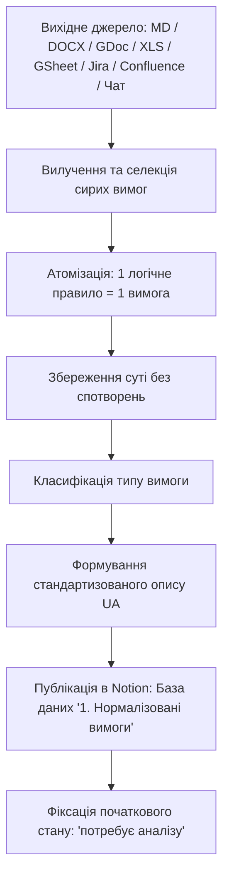

# Requirements Normalizer (Нормалізатор Вимог для QA)

Цей скіл виконує системну декомпозицію та нормалізацію вимог будь-якого формату до атомарного, несуперечливого, однозначного і тестованого стану **без зміни їхньої первинної суті, бізнес-логіки та обмежень**, із обов'язковим експортом структурованих записів у Notion-базу даних **«1. Нормалізовані вимоги»**.

Усі вихідні формулювання, нормалізовані записи, назви та артефакти ведуться **виключно українською мовою**.

---

## 🛡️ Золоте Правило: Незмінність Суті (Intent Preservation Rule)

> [!CAUTION]
> **Категорично заборонено змінювати зміст, логіку, обмеження або додумувати вимоги!**
> 1. Нормалізація полягає **лише у розбитті на атомарні компоненти** (одне правило / один факт / одна дія = один запис) та приведенні форми формулювання до чіткого тестованого стандарту.
> 2. Заборонено прибирати граничні значення, коди помилок, статуси або інтервали, вказані замовником.
> 3. Заборонено додавати власні припущення ("від себе"). Якщо у вихідній вимозі є невизначеність чи прогалина — вона фіксується у первинному вигляді, а стан запису залишається **«потребує аналізу»** із зауваженням у колонці «Нормалізація».

---

## 📥 Підтримувані Вихідні Джерела

Скіл підтримує вилучення сирих вимог із наступних джерел:

| Тип джерела | Спосіб обробки агентом |
|---|---|
| **Markdown (.md)** | Пряме читання через `view_file`. |
| **Microsoft Word (.docx)** | Вилучення тексту та таблиць через Python (`python-docx`). |
| **Google Docs** | Читання через інструменти `gdrive` MCP (`readGoogleDoc`, `getGoogleDocContent`) або експорт у Markdown. |
| **Excel / CSV (.xlsx, .csv)** | Зчитування через Python (`pandas`, `openpyxl`) або CSV-парсер. |
| **Google Sheets** | Зчитування через `gdrive` MCP (`getGoogleSheetContent`, `getGoogleSheetCells`). |
| **Jira (експорт або Jira MCP)** | Зчитування з файлів експорту (CSV, Excel, XML, JSON) або напряму через інструменти `jira-ithillel` MCP (`jira_get_issue`, `jira_search_issues`). |
| **Confluence (експорт сторінок)** | Обробка експортованих документів Confluence (Word `.docx`, PDF, HTML, Markdown) або копій сторінок специфікацій (PRD, SRS). |
| **Текст у чаті з агентом** | Безпосередній аналіз повідомлень, переданих користувачем у діалозі. |

---

## 🔄 Життєвий Цикл Нормалізації (Workflow)



---

## 📐 Критерії Нормалізованої Вимоги (ISO/IEC/IEEE 29148)

Кожна нормалізована вимога повинна задовольняти 5 критеріїв:
1. **Атомарність (Atomic):** Містить рівно одне неподільне правило валідації або одну поведінкову реакцію системи.
2. **Однозначність (Unambiguous):** Виключає слова-паразити та суб'єктивні оцінки (*«швидко»*, *«зручно»*, *«користувач легко знаходить»*, *«оптимально»*). Використовуються точні критерії.
3. **Тестованість (Testable / Verifiable):** Для вимоги можна скласти однозначний тест-кейс з очікуваним результатом Pass/Fail.
4. **Простежуваність (Traceable):** Має чітке посилання на джерело (номер пункту в ТЗ, назву файлу, назву вкладки таблиці, ключ тикета Jira, сторінку Confluence чи цитату з чату).
5. **Незмінність істинності:** Повний набір атомарних вимог у сумі в точності відтворює вихідну бізнес-вимогу без втрат і без надлишку.

---

## 🗄️ Мапінг Полів у Базу Даних Notion («1. Нормалізовані вимоги»)

При збереженні кожного нормалізованого запису в базу даних Notion заповнюються наступні поля:

| Колонка в Notion | Тип даних Notion | Правило заповнення |
|---|---|---|
| **Назва** | `TITLE` | Коротка суть вимоги українською мовою (наприклад: *«Валідація мінімальної довжини пароля»*, *«Перевірка унікальності Email при реєстрації»*). |
| **ID нормалізованої вимоги** | `auto_increment_id` | Автоматично присвоюється Notion (префікс `REQ-`). |
| **Нормалізована вимога** | `RICH_TEXT` | Чітке атомарне формулювання українською: **«Система/Користувач повинна [дія/перевірка] за умови [контекст]»**. |
| **Тип** | `SELECT` | Одне з фіксованих значень: <br>• `Функціональна` <br>• `Нефункціональна` <br>• `Бізнес-вимога` <br>• `Технічна` <br>• `Інтеграційна` |
| **Джерело** | `RICH_TEXT` | Точна назва джерела, файл, рядок, аркуш, тікет Jira або сторінка Confluence (наприклад: `Jira PROJ-142, Description` або `Confluence: SRS Auth, розд. 3.2`). |
| **Нормалізація** | `RICH_TEXT` | Аргументація розбиття: які частини вихідного складного речення виділено та чому це окрема вимога. |
| **Стан** | `STATUS` | **ОБОВ'ЯЗКОВО: `потребує аналізу`** (дефолтний початковий статус для всіх нових вимог; інші: `в процесі аналізу`, `узгоджено`, `відхилено`). |
| **Ким підтверджено** | `RICH_TEXT` | **Заповнюється ВИКЛЮЧНО для підтверджених/узгоджених вимог** (зі станом `узгоджено`). Вказується ПІБ, роль або стейкхолдер (наприклад: *«Станіслав Подзолков (QA Lead / PM)»*, *«Клієнт / Product Owner»*). Для вимог у статусі `потребує аналізу` або `в процесі аналізу` це поле **завжди залишається порожнім (`null`)**. |

> [!NOTE]
> **🔗 Зв'язок із блоком аналізу та вирішенням вимог:**
> Всі нові вимоги створюються зі станом `потребує аналізу`. На наступному етапі аудиту (скіл `requirements-analyzer`) проблемні вимоги заносяться до блоку аналізу (Розділ 2 Notion).
> **Правило виключення з файлу аналізу:** якщо в блоці аналізу вимог біля вимоги встановлено статус **`взята в роботу`** або **`вирішена`**, вона **НЕ потрапляє у файл аналізу (`clarifications/*.md`)**, що генерується скілом `requirements-resolver`.

### Вміст сторінки вимоги (Page Content в Notion)
Всередині кожної окремої сторінки вимоги генерується структурований Markdown:
```markdown
### 📌 Вихідний текст вимоги (Цитата)
> "[Точний фрагмент цитати з джерела без змін]"

### 🎯 Контекст та передумови (Preconditions)
- Стан системи перед виконанням перевірки.

### 🧪 Очікуваний результат (Expected Result)
- Однозначний спостережуваний результат для QA інженера.

### 🔍 Критерії приймання (Acceptance Criteria)
- [ ] Критерій 1 (позитивний сценарій)
- [ ] Критерій 2 (негативний сценарій / граничне значення)
```

---

## 🛠️ Робота з Джерелами: Покрокові Інструкції

### 1. Якщо джерело — Markdown (.md)
1. Прочитати вміст файлу за допомогою `view_file`.
2. Знайти функціональні розділи (Use Cases, User Stories, Acceptance Criteria, API описи).
3. Виділити складні складені речення із сполучниками: *«і»*, *«а також»*, *«але»*, *«якщо ..., то ..., інакше ...»*.
4. Розбити кожне таке речення на окремі атомарні вимоги.

### 2. Якщо джерело — Microsoft Word (.docx)
1. Використати короткий python-скрипт для зчитування параграфів та таблиць безпосередньо з `.docx`:
```python
import docx

doc = docx.Document("path/to/document.docx")
text = "\n".join([p.text for p in doc.paragraphs if p.text.strip()])
for table in doc.tables:
    for row in table.rows:
        row_text = " | ".join([cell.text.strip() for cell in row.cells])
        print(row_text)
```
2. Зберегти вихідні посилання на номери сторінок або розділів документу.

### 3. Якщо джерело — Google Docs
1. Знайти документ через інструмент `gdrive:search`.
2. Викликати `gdrive:getGoogleDocContent` або `gdrive:readGoogleDoc`.
3. Опрацювати отриманий текст за правилами нормалізації.

### 4. Якщо джерело — Excel (.xlsx, .csv) або Google Таблиці (Google Sheets)
1. Для Excel/CSV: зчитати аркуші через `pandas.read_excel()` або стандартну бібліотеку `csv`.
2. Для Google Sheets: викликати `gdrive:getGoogleSheetContent`.
3. Визначити, чи рядки вже є вимогами. Якщо в одному рядку описано декілька правил (наприклад, валідація полів форми в одній комірці) — декомпозувати рядок на декілька окремих записів у Notion.

### 5. Якщо джерело — Jira (Експорт або Jira MCP)
1. **З файлів експорту Jira (CSV, Excel, XML, JSON):**
   - Зчитати колонки `Issue key`, `Summary`, `Description`, `Acceptance Criteria`, `Environment`.
   - Якщо поле `Description` або `Acceptance Criteria` містить маркований список або декілька умов — декомпозувати кожну умову в окрему атомарну вимогу.
2. **Через підключений інструмент `jira-ithillel` MCP:**
   - Отримати дані задачі за ключем: `jira_get_issue(issueKey="PROJ-123")`.
   - Знайти пов'язані задачі епіку через JQL: `jira_search_issues(jql="parent = PROJ-100")`.
   - Вилучити сирі вимоги з `fields.description` та `fields.customfield_*`.
3. Вказати в полі **«Джерело»**: наприклад, `Jira: PROJ-123 (Реєстрація користувача)` або `Jira Export CSV, рядок 14`.

### 6. Якщо джерело — Confluence (Експорт або сторінки)
1. **З файлів експорту Confluence (Word `.docx`, PDF, HTML, Markdown):**
   - Вилучити текст розділів специфікацій вимог до продукту (PRD), архітектурних документів (SRS) та таблиць матриці вимог.
   - Для HTML-експорту Confluence використати парсинг через Python `BeautifulSoup` для отримання чистих текстових блоків та таблиць `confluenceTable`.
2. Зберегти точну ієрархію: Простір Confluence -> Батьківська сторінка -> Розділ документу.
3. Вказати в полі **«Джерело»**: наприклад, `Confluence: Space 'QA', Page 'SRS v2.1', розд. 4.2`.

### 7. Якщо джерело — Чат з агентом
1. Взяти повідомлення користувача в поточному чаті як первинний документ.
2. Якщо користувач передав неструктуровані нотатки чи тези — виокремити бізнес-правила без додавання неіснуючих умов.
3. Вказати в полі **«Джерело»**: `Повідомлення користувача в чаті`.

---

## 🚀 Порядок Збереження в Notion через MCP

1. **Знайти Data Source ID** бази даних «1. Нормалізовані вимоги»:
   - Відомий ідентифікатор у воркспейсі: `collection://7882d176-0f8f-4c66-b396-604989a9ea81` (або виконати `notion-search` з запитом `1. Нормалізовані вимоги`).
2. **Сформувати пакетний запит `notion-create-pages`**:
   ```json
   {
     "parent": {
       "type": "data_source_id",
       "data_source_id": "7882d176-0f8f-4c66-b396-604989a9ea81"
     },
     "pages": [
       {
         "properties": {
           "Назва": "Перевірка довжини імені користувача",
           "Нормалізована вимога": "Поле «Ім'я» повинно приймати значення довжиною від 2 до 50 символів включно.",
           "Тип": "Функціональна",
           "Джерело": "Jira PROJ-45: Registration Form validation",
           "Нормалізація": "Виділено в окрему атомарну вимогу з комплексного правила валідації форми",
           "Стан": "потребує аналізу",
           "Ким підтверджено": null
         },
         "content": "### 📌 Вихідний текст вимоги\n> \"Ім'я користувача обов'язкове, від 2 до 50 символів, дозволені літери та дефіс, при помилці виводити відповідне повідомлення.\"\n\n### 🎯 Передумови\n- Форма реєстрації відкрита.\n\n### 🧪 Очікуваний результат\n- Введення 2..50 символів є валідним; <2 або >50 символів викликає помилку валідації."
       }
     ]
   }
   ```
3. Після збереження вивести користувачеві звіт зі зведеною таблицею нормалізованих вимог та прямими посиланнями на створені картки в Notion.

---

## 💡 Приклад Нормалізації (Before & After)

### ❌ Вихідний сирий текст (Jira тикет / Confluence / ТЗ / Чат):
> *"Користувач реєструється за допомогою Email і пароля (мінімум 8 символів з великою літерою і цифрою), після чого отримує лист підтвердження на пошту з посиланням, що діє 24 години, а якщо пошта вже зайнята, система повинна повернути помилку 409 Conflict."*

### ✅ Результат нормалізації (4 атомарні вимоги):

1. **REQ-A1:**
   - **Назва:** Валідація складності пароля при реєстрації
   - **Нормалізована вимога:** Пароль користувача повинен містити не менше 8 символів, щонайменше одну велику літеру та щонайменше одну цифру.
   - **Тип:** `Функціональна`
   - **Джерело:** `Jira: PROJ-88 / Confluence: Auth Spec v1.0`
   - **Нормалізація:** Виокремлено правило валідації пароля від поштових процесів та статус-кодів.
   - **Стан:** `потребує аналізу`
   - **Ким підтверджено:** `—` *(порожньо, заповнюється лише після зміни стану на «узгоджено»)*

2. **REQ-A2:**
   - **Назва:** Відправка листа підтвердження після реєстрації
   - **Нормалізована вимога:** Після успішного створення облікового запису система повинна відправити лист із посиланням підтвердження на вказаний Email.
   - **Тип:** `Функціональна`
   - **Джерело:** `Jira: PROJ-88 / Confluence: Auth Spec v1.0`
   - **Нормалізація:** Виокремлено процес сповіщення користувача.
   - **Стан:** `потребує аналізу`
   - **Ким підтверджено:** `—` *(порожньо, заповнюється лише після зміни стану на «узгоджено»)*

3. **REQ-A3:**
   - **Назва:** Термін дії посилання підтвердження акаунту
   - **Нормалізована вимога:** Посилання для підтвердження облікового запису в листі повинно бути дійсним протягом 24 годин з моменту генерування.
   - **Тип:** `Функціональна`
   - **Джерело:** `Jira: PROJ-88 / Confluence: Auth Spec v1.0`
   - **Нормалізація:** Виокремлено часове обмеження токена активації.
   - **Стан:** `потребує аналізу`
   - **Ким підтверджено:** `—` *(порожньо, заповнюється лише після зміни стану на «узгоджено»)*

4. **REQ-A4:**
   - **Назва:** Обробка дублікатів Email при реєстрації
   - **Нормалізована вимога:** При спробі реєстрації з уже зареєстрованою в системі адресою Email система повинна повернути HTTP статус 409 Conflict.
   - **Тип:** `Технічна`
   - **Джерело:** `Jira: PROJ-88 / Confluence: Auth Spec v1.0`
   - **Нормалізація:** Виокремлено негативний сценарій та контрактний HTTP статус-код.
   - **Стан:** `узгоджено` *(приклад підтвердженої вимоги)*
   - **Ким підтверджено:** `Станіслав Подзолков (PM / QA Lead)` *(заповнено, оскільки вимогу узгоджено)*
